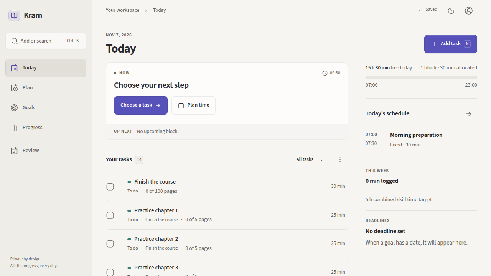

<div align="center">
  
  <h1>Kram</h1>
  <p>A self-hosted planner for goals, time, and steady progress.</p>
  <p><a href="#get-started">Get started</a> · <a href="CONTRIBUTING.md">Contribute</a> · <a href="ACKNOWLEDGEMENTS.md">Credits</a></p>
</div>



Kram turns goals into a timetable, records your work, and proposes what to do next. Each installation has one owner and its own data. It runs on a PC, laptop, or Raspberry Pi.

## Features

- Goals, resources, recurring tasks, and semester class timetables.
- Explainable scheduling with changes you can review and approve.
- Timers, progress history, daily and weekly reviews, and streaks.
- Offline progress, backups, and optional ntfy or Telegram reminders.

## Get started

You need Docker with Compose. Use SSD storage for a Raspberry Pi database.

```bash
bash scripts/setup.sh
docker compose up --build -d --wait
docker compose exec app /app/infra/entrypoint.sh \
  node dist/server/cli.js create-owner --email=you@example.com
```

Setup generates private local secrets; owner creation prompts for your password. Open **http://localhost:8420**. For remote access, use HTTPS over a private VPN or authenticated proxy; see [Security](SECURITY.md). [Encrypted backup and recovery](infra/backup/RECOVERY.md) are optional.

## Development

Use Node **22.20+** and Docker. See [Contributing](CONTRIBUTING.md) for local setup and checks.

## License and credits

Kram is [MIT licensed](LICENSE). Third-party libraries, fonts, infrastructure, and design inspiration are credited in [Acknowledgements](ACKNOWLEDGEMENTS.md); their own licenses apply.
